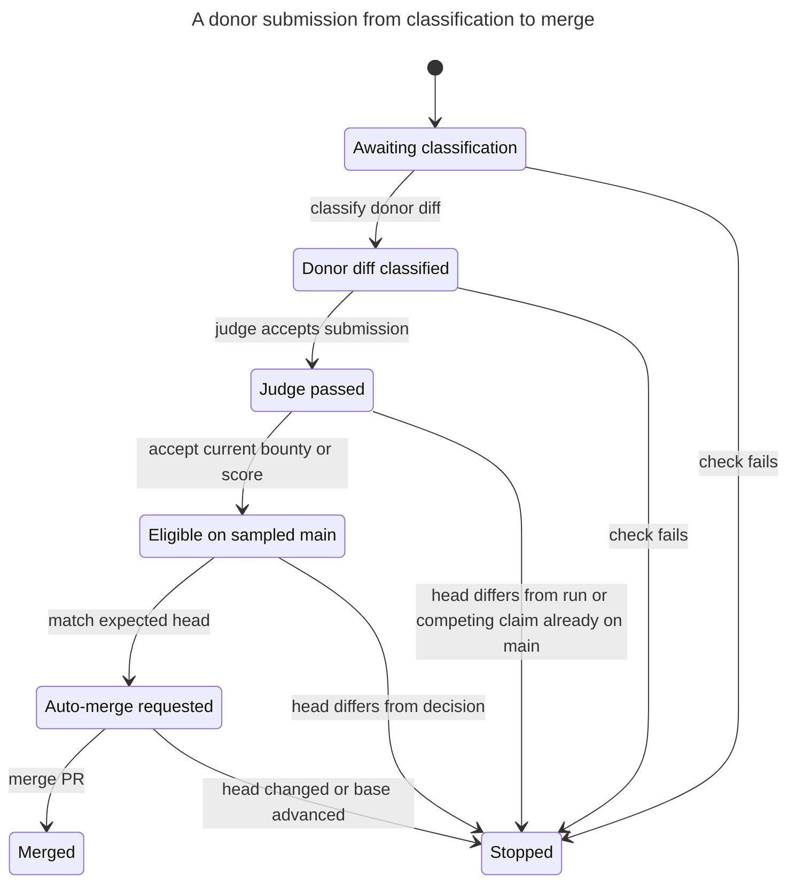
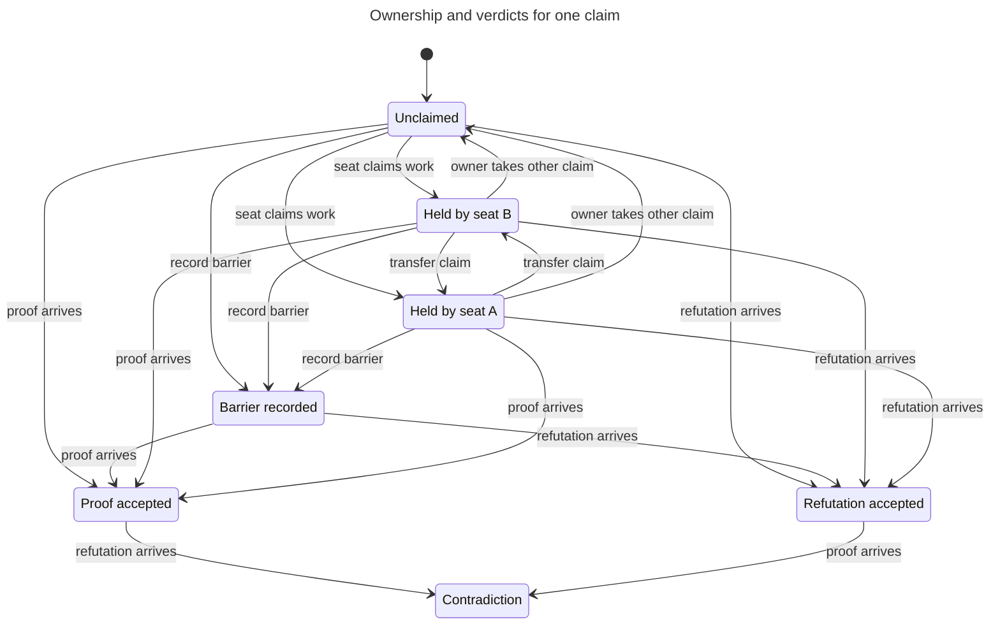

# Proof Foundry protocol checks

TLC exhaustively explored both finite models. Every configured invariant held, both queues emptied, and the built-in deadlock check passed. The merge result depends on the authorized head and current base still matching when the PR lands.

| Model | Generated states | Distinct states | TLC search depth | Reachability diameter (transitions) | Errors |
| --- | ---: | ---: | ---: | ---: | ---: |
| PR gate and merge | 248 | 112 | 7 | 6 | 0 |
| Claim and seat lifecycle | 174 | 36 | 5 | 4 | 0 |

The diameter is the maximum shortest distance from an initial state. TLC reports initial states at depth one. Both models use one worker, breadth-first search, and the default deadlock check, with no search constraints or symmetry reduction. Neither protocol promises eventual progress. A contributor can keep changing the head, and a second verdict may never arrive.

## PR gate and merge

One run starts at head `H0` on base `B0`. The PR ref can move to a second commit or back at any stage. Main can advance once, independently, through an unrelated merge, a duplicate bounty, or a competing record. The modeled minimization candidate scores 7. It improves an incumbent of 8, ties 7, and loses to 6.

The classifier and judge each compare the fetched head with the event SHA. Each successful step records the SHA it actually inspected. The eligibility job compares the fetched head to the successful run and evaluates the claim on its main snapshot. The merge job requests auto-merge with `--match-head-commit`. A separate transition represents the eventual landing. In a merged state, `mergedSHA` is the PR head included in the squash and `main` is the base immediately before the update. [Judge workflow](../.github/workflows/judge.yml) · [Auto-merge workflow](../.github/workflows/auto-merge.yml) · [Eligibility and score checks](../hub/pr_gate.mjs)

- **NeverMergeUnjudgedCommit** requires the merged head to match both the successful donor classification and the successful judge receipt.
- **NeverMergeStaleClaim** checks the claim again as an invariant against the base at landing. The merge action itself never calls the eligibility predicate.
- **NoDeadlock** checks that every reachable state has a successor. A stopped or completed run has an explicit stuttering `Done` action.

The run assumes a protected main without bypass. Under strict up-to-date checks, the original head cannot land once main has advanced beyond its parent. Updating the PR to contain the new base creates a new head and requires a fresh run. On 2026-11-23 the repository rules API returned `gate` with `strict_required_status_checks_policy: true`. The repository settings API returned `allow_auto_merge: false`. These settings can change. [Main branch rules](https://api.github.com/repos/steph4n-gh/proof-foundry/rules/branches/main)

**Deferred merge assumption.** The model requires the final merge to consume authorization for the same head that passed eligibility. GitHub documents that a push by someone without write permission disables auto-merge. The documentation gives no equivalent guarantee for every writer. A synchronous merge with an expected-head condition can satisfy this assumption directly. The hosted deferred path for write-capable contributors remains unverified. [GitHub auto-merge behavior](https://docs.github.com/en/pull-requests/collaborating-with-pull-requests/incorporating-changes-from-a-pull-request/automatically-merging-a-pull-request) · [GitHub CLI merge options](https://cli.github.com/manual/gh_pr_merge)

Turning off one condition at a time produced these shortest model counterexamples. All other conditions remained enabled.

| Condition disabled | Invariant violated | Shortest path | Observation |
| --- | --- | ---: | --- |
| `PinJudgeInputs` | NeverMergeUnjudgedCommit | 7 transitions | Classification and judging can observe different revisions even though the head matches the workflow event again at decision and merge. |
| `RequireCurrentBase` | NeverMergeStaleClaim | 6 transitions | A competitor can land after eligibility and consume the same bounty before the authorized head merges. A tied or beaten record uses the same timing. |
| `RequireAuthorizedHead` | NeverMergeUnjudgedCommit | 6 transitions | A matching request can succeed, then a different head can land if the old authorization survives the change. |

At source revision `16e069d` the two judge workflow jobs independently fetched the moving PR ref. The checked configuration specifies the hardened contract. The model covers a single donor run and abstracts job failures into a stopped run. Judge soundness, Git conflicts, native queue internals, privileged overrides, and the behavior of a fresh run on a rebased head are outside its scope. The chart combines states by workflow phase and hides head and base changes that leave the phase unchanged.



## Claim and seat lifecycle

Two seats can compete for either of two claims. Transferring a claim clears the previous seat's pointer. Moving a seat to another claim clears its previous claim's owner. One target receives judge verdicts and barrier rulings. Its `open` state corresponds to `conjecture` when unowned and `in_work` when assigned. A ruling or verdict releases both sides of the assignment.

Proof and refutation events represent successful receipts at writeback or replay. Either one can arrive first, either can repeat, and a barrier can arrive between them. A receipt from an already running judge can arrive after a barrier. An independent set records which receipt kinds have arrived. The status transition reads the current verdict, while the convergence invariant reads the set. [Fleet commands](../hub/fleet.mjs) · [Submission replay](../hub/missions.mjs)

- **ContradictionIsSticky** remembers whether an earlier state reached contradiction and checks subsequent deliveries.
- **SingleSeatPerClaim** counts the seats pointing at each claim. **SeatClaimBijection** independently checks the domain of both maps and both directions of every seat–claim pair.
- **ClosedClaimReleased** requires the target to have no owner after a verdict or barrier.
- **BarrierNeverOverwritesVerdict** compares the status immediately before and after a barrier attempt.
- **OrderIndependentContradiction** requires contradiction as soon as both receipt kinds have arrived.
- **NoDeadlock** checks every state, including the terminal contradiction verdict, where `Done` stutters. Duplicate and late deliveries remain enabled to check stickiness.

The model starts with consistent empty assignments and treats each reducer writeback as atomic. It covers ownership of both claims and the verdict lifecycle of the target. Preflight, worker scheduling, lock implementation, legacy data repair, receipt contents and record scoring are outside this model. The chart hides duplicate receipts, rejected barriers and ownership changes that leave the target's label unchanged.

On `16e069d`, local checks against submission replay confirmed both receipt orders and preservation of all three verdicts under a barrier. The original CLI had separate ownership and verdict writers. A local check of the parallel unified reducer exercised simultaneous displacement of both old owners, release on verdict, barriers between opposite receipts, and duplicate deliveries after contradiction. Scratch mutations that retained the old seat pointer, overwrote a verdict with a barrier, or discarded the first refutation each violated the corresponding invariant.



## Reproduce

Run from the repository root with the installed statechart skill. The checked run used Node 26.9.0, TLC 2.19 from the TLA+ tools 1.7.4 release, and Temurin 25.0.5.1+2. The runner can obtain TLC and Java through `mise`. For an existing installation, export `TLA2TOOLS` as the absolute path to `tla2tools.jar` and `JAVA` as the absolute path to the Java executable. [TLA+ tools 1.7.4](https://github.com/tlaplus/tlaplus/releases/tag/v1.7.4)

```sh
runner="${STATECHART_SKILL:-$HOME/.codex/skills/statechart}/scripts/statechart"
out=$(mktemp -d)
for model in pr_gate_merge claim_seat_lifecycle; do
  "$runner" "formal/$model.tla" --config "formal/$model.cfg" \
    --view "formal/$model.view.mjs" --out "$out/$model" || exit 1
  cat "$out/$model/report.md"
  rg 'states left on queue|depth of the complete state graph' "$out/$model/tlc.out"
done
```

The following commands reproduce the three PR counterexamples in the same scratch directory. The runner returns status 1 for a violated invariant. Each report names the rule and gives the shortest path.

```sh
for condition in PinJudgeInputs RequireCurrentBase RequireAuthorizedHead; do
  sed "s/$condition = TRUE/$condition = FALSE/" formal/pr_gate_merge.cfg > "$out/$condition.cfg"
  "$runner" formal/pr_gate_merge.tla --config "$out/$condition.cfg" \
    --view formal/pr_gate_merge.view.mjs --out "$out/$condition" || test "$?" -eq 1 || exit 1
  cat "$out/$condition/report.md"
done
```
